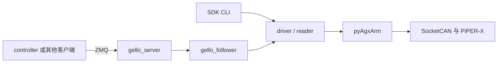

# 架构与数据流

## 模块边界



`reader` 不使能；`driver` 校验反馈、状态、限位和运动；`gello_follower` 提供七维状态、JS 控制和夹爪映射；`gello_server` 处理网络请求。服务不读 GELLO 串口，不负责主从方向、episode 或数据转换。controller 的 `robot_client.py` 与此协议对接。

## 服务生命周期

服务启动时连接、默认写入并确认 `3.0 rad/s` 和 `5.0 rad/s²` 关节限制，然后使能并读取状态；第一帧客户端目标到达时进入 JS 流式会话。`--hz` 限制硬件命令发送频率，不保证观测采样频率。服务本身不设置规划速度百分比，也不在启动时发送普通 J 保持命令。

SIGINT/SIGTERM 结束服务循环并关闭连接。默认关闭不回零、不失能；controller 在关闭其托管服务前负责尝试 JS 回零。手动管理服务时，必须先让客户端完成退出再停止服务。

## ZMQ 协议

使用 ZMQ REQ/REP 和 Python pickle，默认 endpoint 为 `tcp://127.0.0.1:6001`。只对可信客户端开放；pickle 输入不是安全的公共网络接口。

| request `method` | `args` | 结果 |
| --- | --- | --- |
| `num_dofs` | `{}` | `7` |
| `get_joint_state` | `{}` | 七维 NumPy 状态 |
| `command_joint_state` | `{"joint_state": [J1, J2, J3, J4, J5, J6, G]}` | 成功为 `None` |
| `get_observations` | `{}` | `joint_positions`、`joint_velocities`、`ee_pos_quat`、`gripper_position` |

请求格式为 `{"method": "...", "args": {...}}`；预期的分派错误返回 `{"error": "..."}`。J1～J6 用 rad，夹爪为 `0=闭`、`1=开`，开口为 `G × gripper_max_width_m`。服务直接使用六轴目标，不做主从方向映射。夹爪反馈缺失时使用最近命令，初值 0；速度由反馈差分估算，首次为零。末端为 XYZ 米与 XYZW 四元数；末端反馈缺失时返回零向量，不能当作有效位姿。

## 手动联调

在 SDK 根目录启动 `uv run agilex-sdk-python-server`，再在 controller 根目录运行：

```bash
uv run agilex-controller follow --existing-server
```

该模式仍会进入跟随前回零/对齐并在退出时尝试回零，但不启停 SDK 服务，也不做本地 CAN/SDK 预检。默认日常使用 controller 托管流程，避免重复占用 CAN 或端口。

## 文档导航

- [安装](installation.md)
- [CLI 与全部命令](reference/cli.md)
- [配置](reference/config.md)
- [排障](reference/errors.md)
- [贡献指南](../CONTRIBUTING.md)
- [许可状态](../LICENSE)
